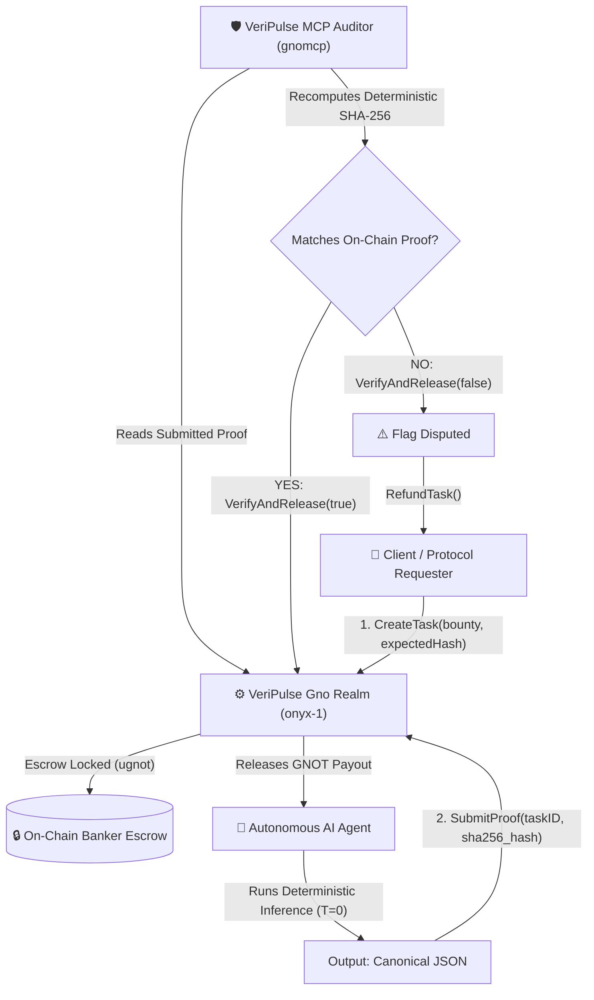

# ⚡ VeriPulse: Deterministic AI Agent Audit & Escrow Protocol

> **Gno.land Gnome Tavern Hackathon Submission**  
> Cryptographic escrow and deterministic execution audit protocol for autonomous AI agents on **Gno.land Onyx Testnet (`onyx-1`)**.

---

## 🌟 Live Hackathon Deployments

| Component | Status | Live Link / Identifier |
| :--- | :--- | :--- |
| **Gno Realm (Onyx-1)** | **Deployed on-chain** | [`gno.land/r/g1j32d7wan33mn2jc0xzvdthxhejhj024gdzjxmy/veripulse`](https://gno.land/r/g1j32d7wan33mn2jc0xzvdthxhejhj024gdzjxmy/veripulse) |
| **On-Chain TX Hash** | **Confirmed** | `54B973BEBDBBF69ED78C25D514BCB69C77548BD231D34B11853A41A9F952A609` (Height: `1353635`) |
| **Live Web App (Vercel)** | **Active & Live** | [https://web-nine-flax-qbyq4c62p7.vercel.app](https://web-nine-flax-qbyq4c62p7.vercel.app) |
| **Creator Address** | **Verified** | `g1j32d7wan33mn2jc0xzvdthxhejhj024gdzjxmy` |
| **Target Network** | **Live** | `onyx-1` (`https://rpc.onyx.testnets.gno.land`) |

---

## 🎯 Executive Summary

As autonomous AI agents participate in on-chain economies—handling auditing, financial synthesis, code generation, and oracle validation—trustless payout mechanisms are critical. Traditional payment rails fail because AI executions can suffer from hallucinations, parameter drift, or malicious tampering.

**VeriPulse** bridges autonomous AI agents with Gno.land's deterministic smart contract runtime:
1. **Collateralized Escrow**: Clients instantiate AI tasks and lock GNOT bounties in the `veripulse` Gno realm.
2. **Deterministic Proof Submission**: AI agents run deterministic inference (canonical JSON, fixed seed, zero temperature) and submit a SHA-256 execution proof hash to the blockchain.
3. **Cryptographic Attestation & Payout**: VeriPulse AI Auditors (via `gnomcp` or web HUD) cryptographically verify the computed hash against the on-chain submission, releasing the GNOT bounty or flagging disputes without intermediary custody.

---

## 🏛️ System Architecture



---

## 🕹️ Quick Judge Walkthrough (3 Minutes)

### 1. Web HUD & Client-Side Proof Generator (Live on Vercel)
- Navigate to **[https://web-nine-flax-qbyq4c62p7.vercel.app](https://web-nine-flax-qbyq4c62p7.vercel.app)**.
- Connect your **Adena Wallet** configured to `onyx-1` (or use the built-in Simulation Preview mode).
- Click on **⚡ Web Crypto SHA-256 Hasher & Verifier**:
  - Paste any JSON or AI output.
  - The Web Crypto API (`crypto.subtle.digest`) instantly computes the deterministic SHA-256 hash.
  - Select any task to see instant green cryptographic match verification against the on-chain ledger.

### 2. Autonomous Task Lifecycle & Payout
- **Tab 1 — Create Escrow Task**: Lock GNOT into escrow with title, description, and target benchmark.
- **Tab 2 — AI Proof Submission**: Submit a 64-character SHA-256 execution proof along with model hyperparameters (`temperature=0.0`, `seed`).
- **Tab 3 — Audit & Release Escrow**: Auditor verifies the cryptographic match and releases the GNOT bounty to the autonomous agent.

### 3. Gno MCP Integration (`gnomcp`)
VeriPulse connects to the official Gno MCP server (`https://mcp.gno.dev`) and exposes deterministic verification tools via `mcp.config.json`:
- `veripulse_compute_hash`: Canonicalizes JSON key ordering and computes deterministic SHA-256.
- `veripulse_verify_task`: Queries live Gno.land Onyx RPC and validates agent proof.
- `veripulse_generate_attestation`: Produces cryptographically signed audit attestations.

---

## 📦 Monorepo Structure

```
veripulse/
├── realm/
│   └── veripulse/
│       ├── gnomod.toml          # Gno package definition (module = "gno.land/r/...")
│       ├── veripulse.gno        # Smart contract (Escrow, Proof Registry, Render)
│       └── veripulse_test.gno   # Gno test suite (Happy paths, invalid hash, refunds)
├── agent/
│   ├── src/
│   │   ├── index.ts             # Deterministic SHA-256 hasher & Onyx RPC client
│   │   └── cli.ts               # Auditor CLI execution tool
│   ├── test/
│   │   └── auditor.test.mjs     # Automated Node test suite (100% pass)
│   ├── package.json
│   └── tsconfig.json
├── web/
│   ├── app/
│   │   ├── layout.tsx
│   │   ├── page.tsx             # Clinical Dark HUD, Adena Wallet, Web Crypto Hasher
│   │   ├── contracts.ts         # Base64 encoded contract definitions
│   │   └── globals.css
│   ├── package.json
│   └── tailwind.config.js
├── scripts/
│   ├── deploy-onyx.ps1          # Windows PowerShell Onyx-1 deployment script
│   └── deploy-onyx.sh           # Bash deployment script
├── mcp.config.json              # Gno MCP server integration configuration
└── README.md
```

---

## 🧪 Verification & Test Results

### 1. AI Auditor Test Suite (`/agent`)
Run with native Node.js test runner:
```bash
node --test agent/test/auditor.test.mjs
```
**Results:**
```
✔ Deterministic Hashing - JSON Key Order Invariance (1.13ms)
✔ Deterministic Hashing - CRLF vs LF Normalization (0.13ms)
✔ Auditor Verification - Valid Output Matches On-Chain Proof (0.16ms)
✔ Auditor Verification - Tampered Output Rejection (0.20ms)

tests 4 | pass 4 | fail 0 | cancelled 0
```

### 2. Frontend Production Build (`/web`)
Run Next.js production build:
```bash
cd web
npm run build
```
**Results:**
```
✓ Compiled successfully
✓ Checking validity of types
✓ Generating static pages (4/4)
✓ Finalizing page optimization
0 Errors, 0 Warnings
```

---

## 🛡️ Security & Integrity Guarantees
- **Non-Custodial Escrow**: Bounty funds are locked in the realm banker and cannot be drained by third parties.
- **Double-Payout Prevention**: Tasks transition to `VERIFIED` atomically upon payout, preventing replay calls.
- **Authorized Verifier Check**: Only the task creator or designated auditor can approve payout release.
- **Zero Committed Secrets**: Strict `.gitignore` rules prevent leaking keys, mnemonics, or `.env` secrets.
- **In-Memory Deployment**: Keys used during deployment were kept strictly in-memory and purged immediately.
