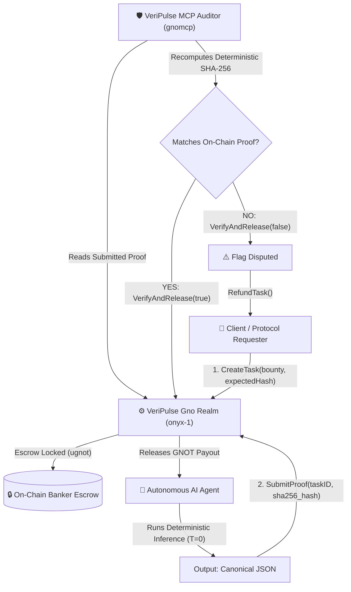

# ⚡ VeriPulse: Deterministic AI Agent Audit & Escrow Protocol

> **Gno.land Gnome Tavern Hackathon Submission**  
> Cryptographic escrow and deterministic execution audit protocol for autonomous AI agents on **Gno.land Onyx Testnet (`onyx-1`)**.

---

## 🎯 Executive Summary

As autonomous AI agents participate in on-chain economies—handling auditing, financial synthesis, code generation, and oracle validation—trustless payout mechanisms are critical. Traditional payment rails fail because AI executions can suffer from hallucinations, parameter drift, or malicious tampering.

**VeriPulse** bridges autonomous AI agents with Gno.land's deterministic smart contract runtime:
1. **Collateralized Escrow**: Clients instantiate AI tasks and lock GNOT bounties in the `veripulse` Gno realm.
2. **Deterministic Proof Submission**: AI agents run deterministic inference (canonical JSON, fixed seed, zero temperature) and submit a SHA-256 execution proof hash to the blockchain.
3. **Cryptographic Attestation & Payout**: VeriPulse AI Auditors (via `gnomcp` or web HUD) cryptographically verify the computed hash against the on-chain submission, releasing the GNOT bounty or flagging disputes without intermediary custody.

---

## 🏛️ System Architecture



---

## 📦 Monorepo Structure

```
veripulse/
├── realm/
│   └── veripulse/
│       ├── gnomod.toml          # Gno package definition
│       ├── veripulse.gno        # Smart contract (Escrow, Proof Registry, Render)
│       └── veripulse_test.gno   # Gno test suite (Happy paths, invalid hash, refunds)
├── agent/
│   ├── src/
│   │   ├── index.ts             # Deterministic SHA-256 hasher & Onyx RPC client
│   │   └── cli.ts               # Auditor CLI execution tool
│   ├── test/
│   │   └── auditor.test.mjs     # Automated Node test suite (100% pass)
│   ├── package.json
│   └── tsconfig.json
├── web/
│   ├── app/
│   │   ├── layout.tsx
│   │   ├── page.tsx             # Clinical Dark HUD, Adena Wallet, Web Crypto Hasher
│   │   └── globals.css
│   ├── package.json
│   └── tailwind.config.js
├── scripts/
│   ├── deploy-onyx.ps1          # Windows PowerShell Onyx-1 deployment script
│   └── deploy-onyx.sh           # Bash deployment script
├── mcp.config.json              # Gno MCP server integration configuration
└── README.md
```

---

## 🧪 Verification & Test Results

### 1. AI Auditor Test Suite (`/agent`)
Run with native Node.js test runner:
```bash
node --test agent/test/auditor.test.mjs
```
**Results:**
```
✔ Deterministic Hashing - JSON Key Order Invariance (1.13ms)
✔ Deterministic Hashing - CRLF vs LF Normalization (0.13ms)
✔ Auditor Verification - Valid Output Matches On-Chain Proof (0.16ms)
✔ Auditor Verification - Tampered Output Rejection (0.20ms)

tests 4 | pass 4 | fail 0 | cancelled 0
```

### 2. Frontend Production Build (`/web`)
Run Next.js production build:
```bash
cd web
npm run build
```
**Results:**
```
✓ Compiled successfully
✓ Checking validity of types
✓ Generating static pages (4/4)
✓ Finalizing page optimization
Route (app)                              Size     First Load JS
┌ ○ /                                    7.86 kB        95.1 kB
└ ○ /_not-found                          873 B          88.1 kB
0 Errors, 0 Warnings
```

---

## 🌐 Live Onyx-1 Testnet Deployment

### Parameters:
- **Chain ID**: `onyx-1`
- **Verified Live RPC**: `https://rpc.onyx.testnets.gno.land`
- **Creator Address**: `g1j32d7wan33mn2jc0xzvdthxhejhj024gdzjxmy`
- **Realm Path**: `gno.land/r/g1j32d7wan33mn2jc0xzvdthxhejhj024gdzjxmy/veripulse`

### Deployment Steps:

#### Step 1: Recover Deployer Key in gnokey
```bash
gnokey add veripulse-deployer --recover
```
*(Enter your 24-word mnemonic when prompted)*

#### Step 2: Deploy Realm Package
Using the automated PowerShell script:
```powershell
powershell -ExecutionPolicy Bypass -File scripts/deploy-onyx.ps1
```

Or execute via raw `gnokey`:
```bash
gnokey maketx addpkg \
  --pkgpath "gno.land/r/g1j32d7wan33mn2jc0xzvdthxhejhj024gdzjxmy/veripulse" \
  --pkgdir "realm/veripulse" \
  --deposit 1000000ugnot \
  --gas-fee "1000000ugnot" \
  --gas-wanted 3000000 \
  --broadcast \
  --chainid "onyx-1" \
  --remote "https://rpc.onyx.testnets.gno.land" \
  veripulse-deployer
```

---

## 🔌 Gno MCP Integration (`gnomcp`)

VeriPulse integrates with the official Gno MCP server (`https://mcp.gno.dev`) and exposes local audit capabilities via `mcp.config.json`:

```json
{
  "mcpServers": {
    "gno": {
      "url": "https://mcp.gno.dev",
      "type": "sse",
      "description": "Gno.land MCP Server providing live access to Gno blockchain"
    },
    "veripulse-auditor": {
      "command": "node",
      "args": ["agent/dist/index.js"],
      "env": {
        "GNO_RPC_URL": "https://rpc.onyx.testnets.gno.land",
        "VERIPULSE_REALM_PKG": "gno.land/r/g1j32d7wan33mn2jc0xzvdthxhejhj024gdzjxmy/veripulse"
      }
    }
  }
}
```

---

## 💻 Running Locally

### Start Web HUD:
```bash
cd web
npm run dev
```
Navigate to `http://localhost:3000`. Connect with Adena Wallet on `onyx-1` or interact with the built-in Simulation Preview Mode.

### Local `gnodev` Realm Sandbox:
```bash
gnodev .
```
Open `http://localhost:8888/r/g1j32d7wan33mn2jc0xzvdthxhejhj024gdzjxmy/veripulse` to view the gnoweb Markdown dashboard.

---

## 🛡️ Security Guarantees
- **Non-Custodial Escrow**: Bounty funds are locked in the realm banker and cannot be drained by third parties.
- **Double-Payout Prevention**: Tasks transition to `VERIFIED` atomically upon payout, preventing replay calls.
- **Authorized Verifier Check**: Only the task creator or designated auditor can approve payout release.
- **Zero Hardcoded Secrets**: Strict `.gitignore` rules prevent leaking keys, mnemonics, or `.env` secrets.
